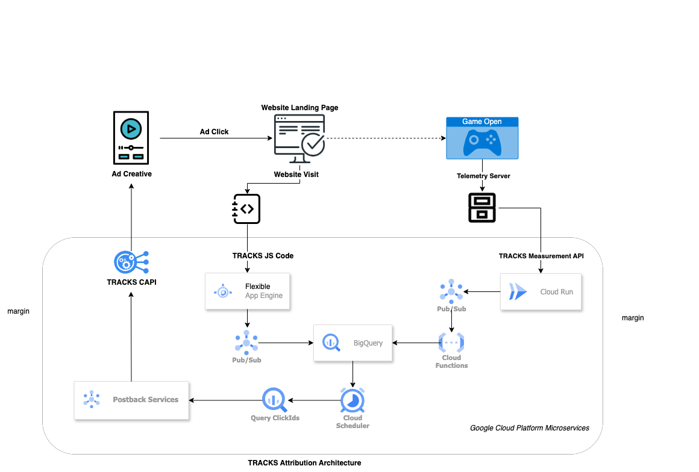

# TRACKS Measurement API

<p class="docs-audience">For: Backend engineer</p>

The Measurement API tracks the customer acquisition source, enabling you to identify which channels, campaigns, ads drive install and other in-game events. By integrating with TRACKS Attribution, you can accurately attribute conversions to the correct media sources, helping you optimize your marketing efforts.

## Architecture

<figure markdown="span">
  
  <figcaption>Measurement API — backend webhook → Cloud Run → BigQuery</figcaption>
</figure>

## Prerequisites

Before you begin, please ensure the following. These apply to the server-side integration described below. The plugin route has its own, much shorter, requirements — see [Telemetry](telemetry.md).

- A Google Cloud Platform account with billing enabled (Google Cloud Platform microservices will auto-scale as needed for your game).
- Your Measurement API key (a bearer token), sent to you in a setup email once your cloud project is provisioned.
- A TRACKS account with the attribution package enabled and ready for integration.
- Basic knowledge of server-side programming, cloud services, and API integrations.
- A telemetry server capable of reading and collecting client IPs via HTTP headers or X-Forwarded-For (XFF).
- A webhook, postback, or proxy mechanism that can trigger real-time Measurement API requests or perform batch uploads via cron jobs.

## Integration approach

To integrate with TRACKS Attribution, you'll need to create and implement a lightweight server-side HTTP request as a webhook on your backend. This is the recommended integration method. If your game has no telemetry backend, see [Telemetry](telemetry.md) for the plugin option.

The webhook should trigger every time a game open (session start) event is logged in your telemetry system.

Every event needs `event_name`, `user_id` and `ip`. The other fields decide how far the reports can break down, so send all of them from day one.

| Field | Required | Example | Notes |
|---|---|---|---|
| `event_name` | Required | `game_open` | One event on every launch. The name is agreed per game. |
| `user_id` | Required | `1dc642cc12345` | Stable per player, and the same on every event. |
| `ip` | Required | `203.0.113.15` | The player's public IP, not your server's and not a LAN address. |
| `timestamp` | Recommended | `2026-08-20T12:00:00Z` | ISO 8601, with `Z` or an offset such as `+02:00`. |
| `is_first_game_open` | Required for installs | `true` | `true` only on the player's very first launch. |
| `first_session_timestamp` | Optional | `2026-08-20T12:00:00Z` | The install time. An alternative install signal when no first-open flag exists. |
| `platform`, `storefront` | Recommended | `PC`, `Steam` | The values are agreed with us before launch. |
| `version` | Recommended | `1.0.3` | The build version. It splits demo and full game. |

Selling DLC or in-game items? See [DLC Tracking](../reporting/dlc.md) and [Free-to-Play Games](../support/free-to-play.md) for the extra fields.

For each game added, the Second Stage Analytics team provides comprehensive support for integration, deployment, and testing, starting with an onboarding call.

??? abstract "API request example"

    ```python
    # Example Python code for server-side telemetry
    import requests

    url = "https://tracks-m.yourgame.com/measure"

    payload = {
        "user_id": "1a23fd44c21f8l5r",
        "event_name": "game_open",
        "ip": "203.0.113.15",
        "timestamp": "2026-08-20T12:00:00Z",
        "is_first_game_open": True,
        "platform": "PC",
        "storefront": "Steam",
        "version": "1.0.3",
    }
    headers = {"Authorization": "Bearer API_KEY"}

    # json= sends the body as JSON and sets Content-Type: application/json
    response = requests.post(url, json=payload, headers=headers, timeout=10)
    print(response.status_code, response.text)
    ```

!!! tip "Test traffic"

    Any event whose body contains the text `test` (in any case, anywhere in the body) is treated as QA traffic and dropped. Watch for words such as *latest* or *contest* in IDs and names. For integration tests, send `"version": "0.0.1-test"`.

## Endpoints

!!! note "Which endpoint do I implement?"

    `/collect` is called by the TRACKS web tag that we deploy through Google Tag Manager — see [Landing Page Integration](../platform/landingpages.md). You don't call it yourself, and it needs no API key.

    `/measure` is called server-side when a game-open (session start) event is logged. This is the endpoint you implement in your own telemetry backend, using the example above.

### `POST /measure` — Record in-game events

| Field | Value |
|---|---|
| **Endpoint URL** | `https://tracks-m.yourgame.com/measure` |
| **Method** | `POST` |
| **Auth** | `Authorization: Bearer <API_KEY>` |
| **Content-Type** | `application/json` (required — a form-encoded body is rejected with `400`) |

**Description:** Records in-game events: game open, DLC and purchase events. The response carries a `message_id` for the accepted event.

### `GET /ip` — Look up the caller's public IP

Returns the caller's public IP address, for example `{"ip": "203.0.113.15"}`. Use it when the game client can't read its own public IP. If your backend forwards the events, it must still send the player's IP, not the server's.

## Testing

**Test the integration:**

- Click on a UTM-tagged test link and open the game for the first time.
- Ensure your server is running and correctly configured to handle HTTP requests.
- Trigger acquisition events manually or through your application to test the integration.
- Check Cloud Run logging to confirm that the endpoint logs show no errors.
- Verify on the attribution tool dashboard that acquisition events are tracked accurately.
- Ensure that the data (channels, campaigns, sources) aligns with your expectations.

## Troubleshooting

- **Invalid Credentials:** Confirm that your API key is correct and sent as `Bearer <API_KEY>`.
- **Network Errors:** Review your server’s network configuration and API base URL.
- **Data Mismatches:** Ensure the event payload matches the required schema and that timestamp formats are correct.

### HTTP status codes

- **200** — Request accepted. The event is queued for processing, and the response carries a `message_id`.
- **400** — `ip` missing, `event_name` or `user_id` missing, or the body isn't JSON (send `Content-Type: application/json`).
- **401** — No `Authorization: Bearer <API_KEY>` header.
- **403** — The key is not valid for this endpoint. Check you are using this game's key.
- **5xx** — Transient server-side error. Retry with exponential backoff; if it persists, contact the Second Stage team.

If problems persist after checking the above, reach out via the [support channels](../support/contact.md).
