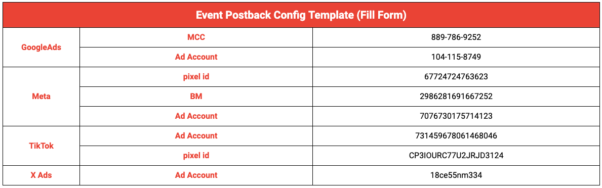

# Postbacks

!!! tip "Do you need postbacks?"

    Postbacks are recommended if you run **conversion-objective campaigns** (targeting ROAS, CPI, or install conversions). They're optional if you only run **awareness or traffic campaigns**. See [Attribution Tracking → Methodologies](../../support/attribution.md#methodologies) for which attribution modes use postbacks.

Postbacks are HTTP requests, typically GET or POST, sent to external servers. TRACKS can transmit installation and in-game event data back to advertising channels using a click ID as the key identifier. This enables platforms like Meta, Google Ads, TikTok, Reddit, Snapchat, X, GA4 and DV360 to identify users with similar behaviors. Instead of focusing solely on clicks, it's more effective to send postbacks for installs and in-game events to optimize campaign performance.

The click ID, collected on the landing page via the TRACKS JavaScript snippet after an ad click, is the only identifier passed along with event data to these advertising channels.

Most media platforms offer an Event/Conversion API (CAPI) module designed for developers. TRACKS' backend can integrate with these platforms' Conversion APIs to post back in-game events, such as installs, that match the click ID collected during attribution. Enabling postbacks closes the loop on tracking and targeting, enhancing media platforms' algorithms to optimize for valuable in-game conversions rather than just ad clicks, engagements, or web conversions. This is particularly beneficial for performance marketing campaigns focused on conversion objectives.

However, for campaigns with objectives such as driving traffic, optimizing for web conversions may be more advantageous, as these occur earlier in the user journey.

Below is an example postback guide template for mapping the Conversion API for various platforms. By utilizing the access provided for media platforms, TRACKS can automatically deploy each platform’s Conversion API from its backend. The TRACKS postback solution can be activated simply by granting editor access for the Events/Dataset management of the media platform.

This one-time setup for each media platform allows TRACKS to implement the Conversion API for your ad accounts without consuming developer resources or relying on third-party solutions like Customer Data Platforms (CDPs).

<figure markdown="span">
  
  <figcaption>TRACKS backend → media-platform Conversion APIs (install + in-game events)</figcaption>
</figure>

## Platform guides

Each platform has its own Conversion API setup path. The per-platform pages below cover the specific steps, tokens, and prerequisites.

-   :fontawesome-brands-meta:{ .lg .middle } &nbsp; __Meta__

    ---

    Events Manager → Conversions API token

    [:octicons-arrow-right-24: Meta CAPI setup](meta.md)

-   :fontawesome-brands-google:{ .lg .middle } &nbsp; __Google Ads__

    ---

    Data Manager API — no developer token

    [:octicons-arrow-right-24: Google CAPI setup](google.md)

-   :fontawesome-brands-tiktok:{ .lg .middle } &nbsp; __TikTok__

    ---

    Direct Advertiser developer profile + Web Events API

    [:octicons-arrow-right-24: TikTok CAPI setup](tiktok.md)

-   :fontawesome-brands-reddit:{ .lg .middle } &nbsp; __Reddit__

    ---

    Events Manager → Conversion access token

    [:octicons-arrow-right-24: Reddit CAPI setup](reddit.md)

-   :fontawesome-brands-x-twitter:{ .lg .middle } &nbsp; __X Ads__

    ---

    Developer app with Ads API access + event IDs

    [:octicons-arrow-right-24: X Ads CAPI setup](x.md)

-   :fontawesome-brands-snapchat:{ .lg .middle } &nbsp; __Snapchat__

    ---

    Business Details → Conversions API token + Pixel ID

    [:octicons-arrow-right-24: Snapchat CAPI setup](snapchat.md)

-   :material-google-analytics:{ .lg .middle } &nbsp; __GA4__

    ---

    Measurement Protocol API secret + Measurement ID

    [:octicons-arrow-right-24: GA4 setup](ga4.md)

-   :fontawesome-brands-google:{ .lg .middle } &nbsp; __DV360__

    ---

    Offline Floodlight conversions via the Data Manager API

    [:octicons-arrow-right-24: DV360 setup](dv360.md)

