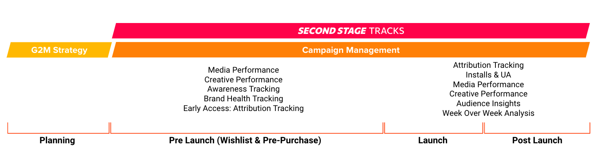

# Platform Functionality

TRACKS combines **marketing analytics** and **attribution tracking** for PC and console games into one platform — covering the full funnel from awareness through install through retention. This page is a feature overview; the conceptual deep-dives live on [Attribution Tracking](../support/attribution.md) and [Marketing Analytics](../support/marketinganalytics.md).

!!! tip "Acronyms on this page"

    Terms like CPI, ROAS, UTM, and ELT are defined in the [Glossary](../glossary.md).

## What TRACKS reports

- **Marketing analytics** — aggregates ad spend, impressions, clicks, web sessions, and storefront events across every channel into one dashboard. Sliceable by date, channel, GEO, campaign, creative, audience, and player cohort. See [Marketing Analytics](../support/marketinganalytics.md).
- **Attribution tracking** — matches installs back to the campaigns that drove them via measured deterministic attribution + probabilistic Markov-chain modelling. Reaches up to 96% accuracy on PC/console. See [Attribution Tracking](../support/attribution.md).
- **Awareness & brand health** — CPM, CPQ, view rate, wishlist additions, brand sentiment signals — first-class KPIs for PC/console where the consideration window is long.
- **Postbacks** — server-to-server conversion signals back to Meta, Google Ads, TikTok, Reddit, Snapchat, X, GA4 and DV360, so ad-network algorithms optimize on real installs rather than proxy events. See [Postbacks](../attribution/postbacks/index.md).

## Across the marketing timeline

<figure markdown="span">
  
  <figcaption>TRACKS across the game marketing timeline — announcement → pre-launch → launch → post-launch</figcaption>
</figure>

**Announcement.** Awareness-led work — building hype across paid, social, and influencers. TRACKS measures campaign reach, creative performance, and brand-health signals, so early marketing beats can be evaluated even before any installs exist.

**Pre-launch.** Upper-funnel awareness continues, but the focus shifts to demand capture — landing-page traffic, wishlists, pre-orders. TRACKS connects each visit and conversion back to the campaign that drove it, including wishlist attribution for Steam.

**Launch.** Real-time install tracking, attribution, and ROAS. TRACKS blends media, web, and attribution data so you can see which campaigns drove which sales across PC and console — not just clicks.

**Post-launch.** Retention, re-engagement, and DLC. Cohort analysis surfaces which acquisition sources produce long-term players; postbacks feed conversion data back to ad networks; web analytics shows how players engage with updates and events.

## Next

- Ready to explore the product? See [Using TRACKS](using-tracks.md).
- Ready to integrate? See [What to Expect](what-to-expect.md) for the journey, or [Architecture](../support/architecture.md) for the technical setup.
- Need hands-on support? See [Contact & Support](../support/contact.md).
