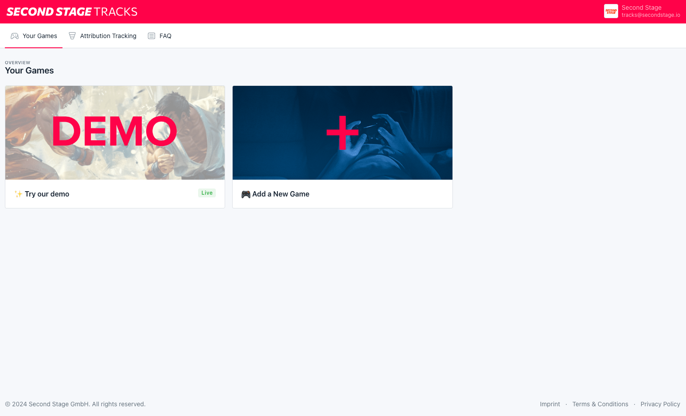
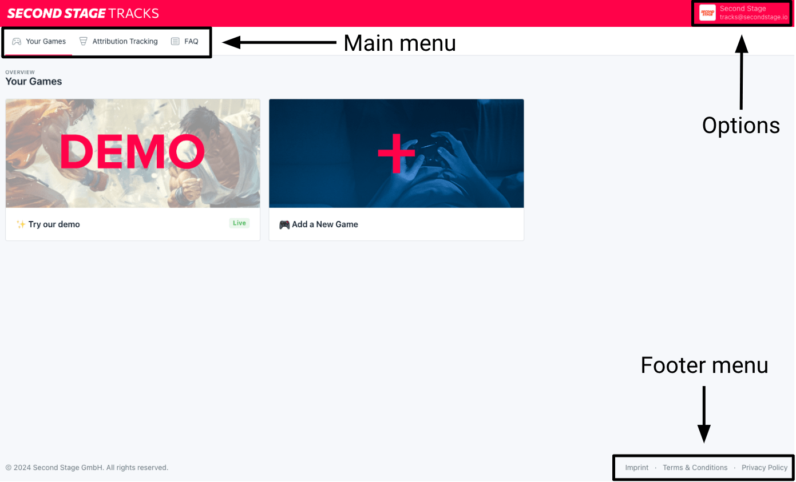
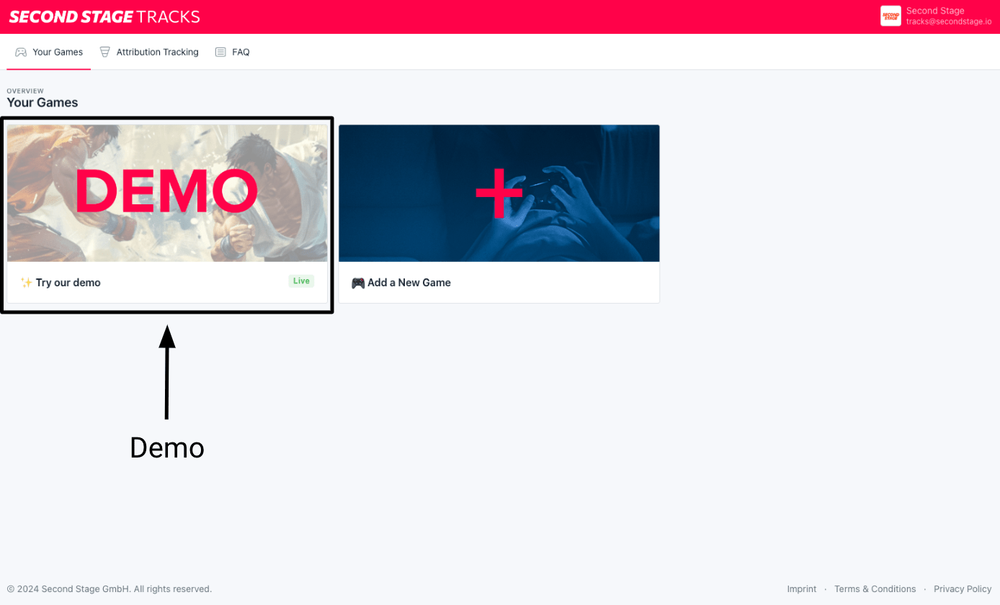
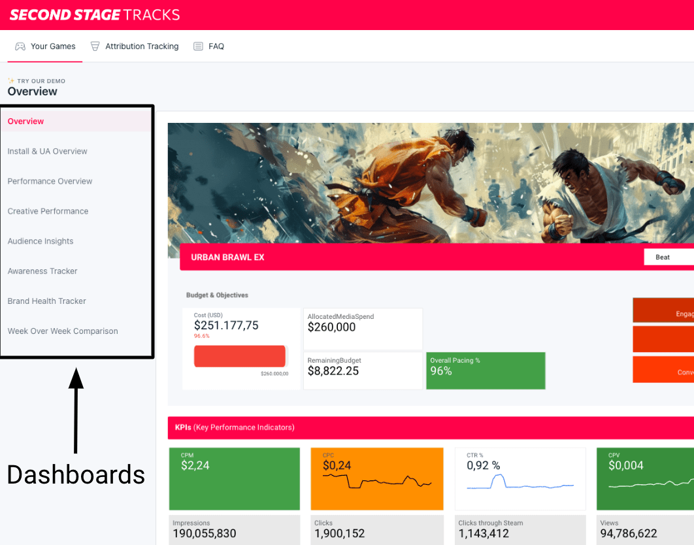
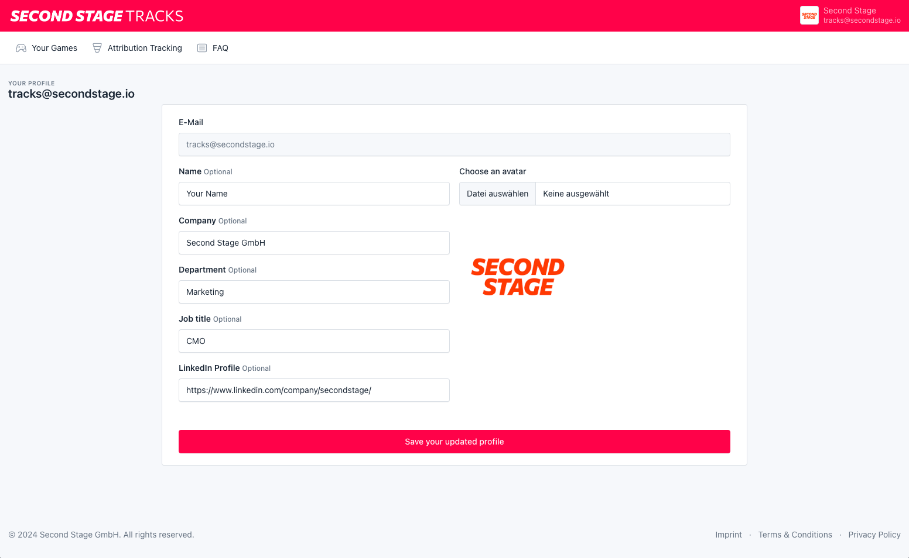
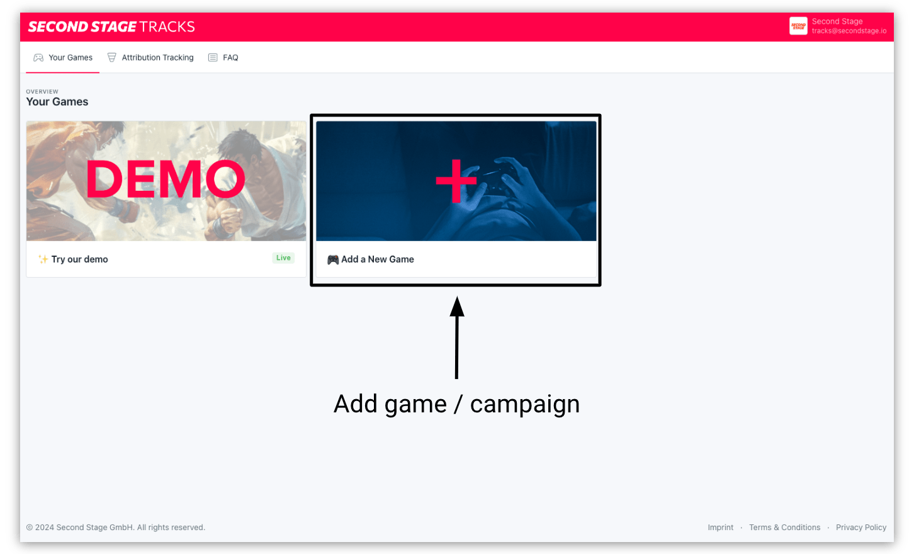

# Using TRACKS

How to set up your TRACKS account, navigate the platform, and register your game or campaign for analytics.

## User Account Setup

TRACKS uses **Magic Link** sign-in — no passwords. Enter your email on the login page and you'll receive a one-time, time-limited link that signs you straight in. If a link expires or has already been used, request a new one from the same screen.

## Navigation

After logging in, you'll be directed to the main overview. Initially, you'll see our demo dashboard, along with an option to add your own game. After you've set up one or multiple games, they will be presented here as well.

<figure class="browser-frame" markdown="span">
  
  <figcaption>TRACKS home — demo dashboard + Add a New Game option</figcaption>
</figure>

In the main menu under "Your Games," you'll find this overview. The "Attribution Tracking" section provides a high-level summary of our in-house attribution tracking solution and overall campaign setup. For more details, check out our FAQ, which addresses common questions.

By clicking on the profile icon or your email address/profile name, you'll find links to "Profile" options as well as a sign-out option.

The footer menu provides links to Imprint, Terms & Conditions and the Privacy Policy.

<figure class="browser-frame" markdown="span">
  
  <figcaption>Main menu — Your Games, Attribution Tracking section, profile + sign-out</figcaption>
</figure>

To view a demo of our campaign dashboards, please click on the demo tile.

<figure class="browser-frame" markdown="span">
  
  <figcaption>Click the demo tile to explore a sample campaign dashboard</figcaption>
</figure>

In the dashboard view, use the menu on the left to navigate between different analytics dashboards for your game. The available dashboards vary based on your plan.

<figure class="browser-frame" markdown="span">
  
  <figcaption>Dashboard view — left menu switches between the dashboards available on your plan</figcaption>
</figure>

## User Account Settings

In the user account option, you can add more information to your account, such as a profile picture, company, job title, or LinkedIn account.

This information helps us to have more inisghts and get in touch with you if we need to, but is completely optional, as we deliberately try to collect as little personal information as possible.

<figure class="browser-frame" markdown="span">
  
  <figcaption>User account — optional profile picture, company, job title, LinkedIn</figcaption>
</figure>

## Game / Campaign Setup

To add a new game to your TRACKS account, select the "Add a New Game" option on the overview page.

<figure class="browser-frame" markdown="span">
  
  <figcaption>Add a New Game — title, platforms, release date, Steam ID, cover image, plan</figcaption>
</figure>

In the next step, enter basic information such as the game's title, intended platforms, release date, and Steam ID, if available. You can also upload a cover image, such as keyart from the game. If no cover image is selected, TRACKS will temporarily display a placeholder image.

Next, select a plan from the available tiers based on the features you need. For details on what each plan includes, see the [product website](https://secondstage.io/tracks/){:target="_blank"}; for plan-fit questions, [Contact & Support](../support/contact.md).

Once the form is submitted, our team will get back to you within 24 hours with a quote and assist you with the full setup.

## Game / Campaign Settings

**Invite teammates** from your game's settings: enter their email address and they receive a Magic Link to sign in. To edit a game's title or change its cover image, [Contact & Support](../support/contact.md).

## Next

- Start connecting ad platforms — see [Platform Integration](../platform/overview.md).
- Understand what TRACKS reports — see [Attribution Tracking](../support/attribution.md) and [Marketing Analytics](../support/marketinganalytics.md).
- Need hands-on support? Our team's hours and contact details are on the [Contact & Support](../support/contact.md) page.
