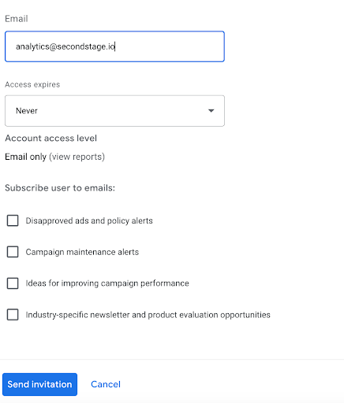

# Google Ads Integration

For: Ad ops / platform admin

In your Google Ads account, click the **Admin** icon.

!!! tip "Next"

    Once access is in place, enable install + in-game event postbacks via the [Google Ads Conversions API](../../attribution/postbacks/google.md).

<ol class="setup-steps" markdown="1">

<li markdown="block">

### Add a new user

Navigate to **Access and Security**, then click the `plus` icon to add a new user.

</li>

<li markdown="block">

### Invite Second Stage

Invite `analytics@secondstage.io` with **Standard** access permissions.

</li>

<li markdown="block">

### Apply the naming conventions

Follow the Campaign, Ad Set, and Ad naming conventions provided in the builder sheet shared by the Second Stage team.

</li>

<li markdown="block">

### Use UTM-tagged links

Ensure your ad creatives use a UTM-tagged link template.

</li>

</ol>

[→ Google Ads Setup Guide](https://support.google.com/google-ads/answer/6372672)

<figure markdown="span">
  
  <figcaption>Google Ads Admin → Access and Security → add user</figcaption>
</figure>
