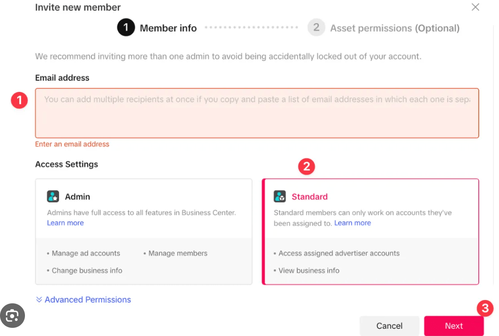

# TikTok Ads Integration

For: Ad ops / platform admin

Grant Second Stage access to your TikTok for Business account so TRACKS can collect campaign and ad-set performance data.

!!! tip "Next"

    Once access is in place, enable install + in-game event postbacks via the [TikTok Conversions API](../../attribution/postbacks/tiktok.md).

<ol class="setup-steps" markdown="1">

<li markdown="block">

### Sign in to TikTok for Business

Log in to your TikTok for Business account with the email that manages your ad account.

</li>

<li markdown="block">

### Open the Members tab

Navigate to the **Members** tab in Business Manager and click **Invite Member**.

</li>

<li markdown="block">

### Invite the Second Stage user

Invite `analytics@secondstage.io` to your Ad Account and Business Manager with **Standard** permissions (assets and ad accounts).

<figure markdown="span">
  
  <figcaption>Business Manager → Members → Invite → Standard permissions</figcaption>
</figure>

</li>

<li markdown="block">

### Apply the naming conventions

Follow the Campaign, Ad Set, and Ad naming conventions provided in the builder sheet shared by the Second Stage team.

</li>

<li markdown="block">

### Use UTM-tagged links

Ensure your ad creatives use a UTM-tagged link template so TRACKS can match clicks to campaigns.

</li>

</ol>
