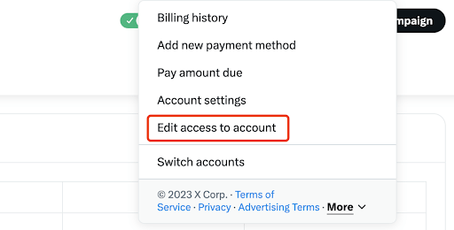

# X Ads Integration

For: Ad ops / platform admin

Grant Second Stage access to your X (Twitter) Ads account and share the details needed for attribution setup.

!!! tip "Next"

    Once access is in place, enable install + in-game event postbacks via the [X Ads Conversions API](../../attribution/postbacks/x.md).

<ol class="setup-steps" markdown="1">

<li markdown="block">

### Open account access

In your ads account, select **Edit access to account** from the drop-down menu.

</li>

<li markdown="block">

### Add the Second Stage user

On the multi-user page, click **Add access** and grant access to `@Analytics_2S` with **Account Administrator** permissions (or invite `analytics@secondstage.io`).

<figure markdown="span">
  
  <figcaption>Edit access to account → Add access → Account Administrator</figcaption>
</figure>

</li>

<li markdown="block">

### Share your ad-account details

Share your handle and ad account details with the Second Stage team so they can complete the integration.

</li>

<li markdown="block">

### Apply the naming conventions

Follow the Campaign, Ad Set, and Ad naming conventions provided in the builder sheet shared by the Second Stage team.

</li>

<li markdown="block">

### Use UTM-tagged links

Use UTM-tagged links in your ad creatives.

!!! note

    X Ads has very limited URL macro support, so give each ad its full tracking URL from the Ad Ops Helper.

</li>

</ol>
